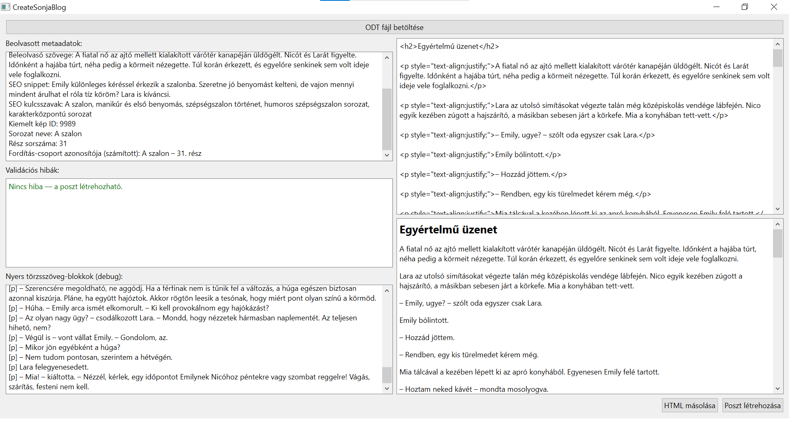

# CreateSonjaBlog

**From a LibreOffice document to a scheduled, multilingual WordPress post in one click.**

A Windows desktop app (Python + PySide6) that publishes posts to [sonjablog.com](https://sonjablog.com). The author writes each post in LibreOffice Writer as a single `.odt` file: a metadata table at the top, the story below it. CreateSonjaBlog reads the file, validates it, generates clean HTML and creates or schedules the post through the WordPress REST API, with no copy-pasting into Elementor.



## What it does

- **Reads `.odt` files.** The first table in the document holds the metadata (title, publish date, categories, teaser, SEO snippet and keywords, featured image ID, language, series name and part number). Everything after it is the post body.
- **Validates before anything is sent.** Missing title, invalid date, unknown categories and empty body are listed in plain language, and the *Create post* button stays disabled until the list is empty.
- **Generates the HTML.** Headings, emphasis, scene breaks and lists are mapped to clean HTML. The first paragraph becomes the story's `<h2>` subtitle under the WordPress post title.
- **Shows a preview.** The parsed metadata and a live, editable HTML preview appear before anything is published.
- **Publishes through the REST API.** It creates the post as scheduled (`status: future`), sets the language, resolves category IDs, fills the RankMath SEO fields and sets the featured image.
- **Handles three languages (hu / en / es) with free Polylang.** The free Polylang plugin has no REST support, so a small WordPress mu-plugin adds the endpoints for setting a post's language and linking its translations. The app tracks translation groups locally, so the Hungarian, English and Spanish versions of a story end up linked automatically.
- **Builds series navigation.** For multi-part stories it appends previous/next navigation with the correct language prefix (`/`, `/en/`, `/es/`), driven by `config/sorozatok.json`.
- **Ships as a single `.exe`.** `build_exe.bat` packages the app with PyInstaller, so the author can run it without installing Python.

## Built spec-first

The project was built with a spec-driven workflow. The full specification, written before and alongside the code and including decisions, edge cases and post-mortems of real bugs, is in [`documentation/CreateSonjaBlog_specifikacio.md`](documentation/CreateSonjaBlog_specifikacio.md) (in Hungarian). It was implemented with Claude Code against that spec.

## Project structure

```
main.py                 # entry point (GUI)
paths.py                # resolves config/state paths relative to the .exe
converter/              # pure logic, no network calls
  odt_reader.py         # ODT parsing, metadata table detection
  metadata_parser.py    # metadata table → structured dict
  validators.py         # all pre-publish validation rules
  html_generator.py     # body → HTML
  navigation.py         # per-language series navigation
wordpress/
  wp_client.py          # REST API calls (post, language, categories, translations)
  config.py             # loads credentials from .env/secrets
  translations.py       # translation-group state
ui/main_window.py       # PySide6 window: metadata preview, error list, HTML editor
config/sorozatok.json   # series configuration (hand-maintained)
tests/                  # unit tests (no network)
```

The processing logic (`converter/`, `wordpress/`) is kept separate from the UI (`ui/`), so a web front end could be added later without rewriting it.

## Getting started

Requirements: Windows, Python 3.10+, and a WordPress site with an Application Password.

**WordPress side (one-time setup):** copy [`wordpress_functions_php_kiegeszites.php`](wordpress_functions_php_kiegeszites.php) to `wp-content/mu-plugins/createsonjablog.php` on the site. This mu-plugin exposes the RankMath SEO fields to the REST API and adds three authenticated endpoints under `sonjablog/v1` (`set-language`, `link-translations`, `category-id`), so the app can drive free Polylang. All of them require the `edit_posts` capability. See section 4 of the spec for details.

```bash
python -m venv .venv
.venv\Scripts\activate
pip install -r requirements.txt
python main.py          # run from the project root
```

Credentials go in `.env/secrets`. That folder is git-ignored and is never committed.

**Run the tests:**

```bash
python -m unittest discover -s tests -t . -v
```

**Build the Windows executable:**

```bash
build_exe.bat           # output: dist/
```

Copy `.env/` and `config/` next to the generated `.exe`. The app creates `state/` itself.

## Tech

Python · PySide6 (Qt) · WordPress REST API · Polylang · RankMath · PyInstaller · unittest

## Out of scope (for now)

Creating new categories, uploading images, inline body images, and editing existing posts.
